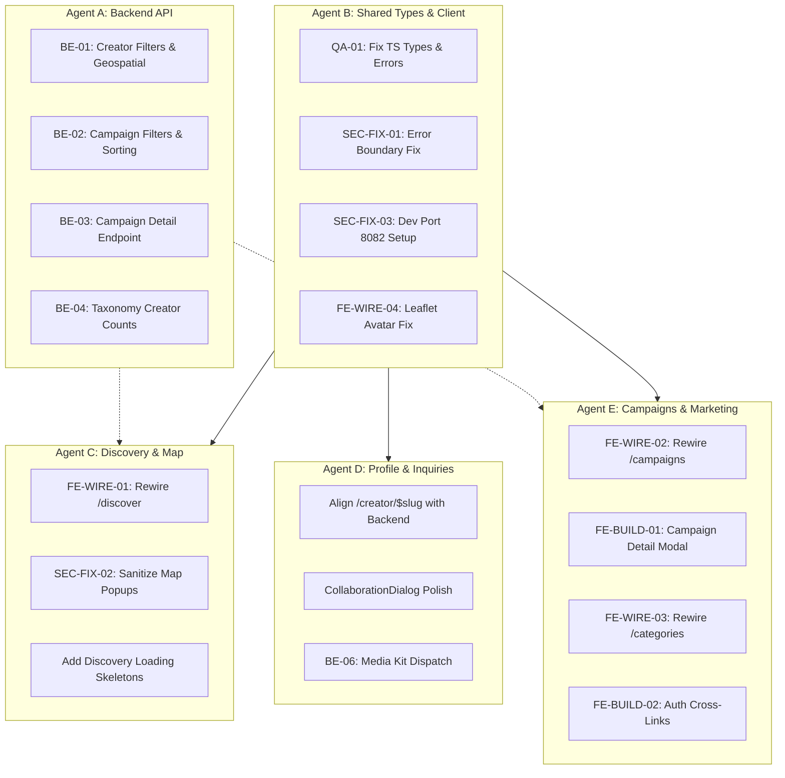

# Kerala Creator Collab (`kerala-creator-collab`) — Completeness & Readiness Audit Report

**Target Frontend:** Public Marketplace Portal (`kerala-creator-collab`)  
**Associated Backend:** Django REST & Channels Core Backend (`backend/`)  
**Audit Date:** November 9, 2026  
**Auditor Role:** Senior Full-Stack Application Architect & Security Engineer  
**Scope:** Read-only architectural, security, integration, and readiness analysis of the public marketplace portal.

---

## 1. Summary and Overall Completion %

### Executive Overview

`kerala-creator-collab` is conceived as the public-facing storefront of the **Influencers.com** platform. Its intended responsibilities are:

1. Public discovery feed of verified creators searchable by niche, location, radius, platform, and reach.
2. An interactive global map (Leaflet) with clustered creator pins.
3. Creator showcase profile pages (`/creator/$slug`) detailing portfolio media, commercial deliverables/rates, testimonials, and past brand collaborations.
4. An inquiry dispatch dialog (`CollaborationDialog`) allowing visiting brands to submit campaign briefs directly to creators.
5. An open campaign opportunities board (`/campaigns`) displaying briefs posted by verified businesses.
6. Static marketing landing pages for creator and business acquisition (`/for-influencers`, `/for-businesses`, `/categories`).

### Current State

The frontend was scaffolded using Lovable as a static/demo prototype with an internal mock database (`src/data/marketplace.ts`). A partial integration layer was subsequently introduced in `src/services/marketplace-api.ts`. However:

- Every API service function wraps its `fetch` request in a `try...catch` block that swallows network and HTTP errors (`console.warn`) and **silently falls back to hardcoded mock data**.
- Dynamic search, radius distance calculations, pricing conversions, and pagination are executed **entirely in browser memory** on mock arrays rather than via the Django REST Framework (DRF) backend.
- Critical CTAs (such as "Join as Influencer", "Log in", and "Create Influencer Profile") hardcode unencrypted HTTP URLs pointing to `http://localhost:8080/signup` and `http://localhost:8080/login`, which fail outside local developer workstations.
- TypeScript compiler (`tsc --noEmit`) fails with **34 errors** across 6 files because interface contracts between the route views and mock data models are out of sync.
- Production error boundaries leak raw JavaScript stack traces to visitors.

### Overall Completion Percentage: **38%**

The overall completion score is calculated as a weighted average across all 8 routes and core infrastructure:

| Route / Component                        | UI Visual Finish | Backend Integration | Error & State Handling | Route Weight |                 Contribution                  |
| :--------------------------------------- | :--------------: | :-----------------: | :--------------------: | :----------: | :-------------------------------------------: |
| **Root Shell & Layout (`__root.tsx`)**   |       90%        |         40%         |          50%           |     10%      |                     6.0%                      |
| **Home Page (`/`)**                      |       95%        |         30%         |          20%           |     15%      |                     7.2%                      |
| **Creator Discovery (`/discover`)**      |       85%        |         30%         |          20%           |     25%      |                     11.2%                     |
| **Creator Profile (`/creator/$slug`)**   |       90%        |         65%         |          40%           |     20%      |                     13.0%                     |
| **Campaigns Board (`/campaigns`)**       |       80%        |         25%         |          15%           |     10%      |                     4.0%                      |
| **Category Explorer (`/categories`)**    |       80%        |         30%         |          15%           |      5%      |                     2.1%                      |
| **For Businesses (`/for-businesses`)**   |       80%        |         10%         |          10%           |     7.5%     |                     1.9%                      |
| **For Influencers (`/for-influencers`)** |       80%        |         10%         |          10%           |     7.5%     |                     2.0%                      |
| **Total Weighted Portal Readiness**      |        —         |          —          |           —            |   **100%**   | **47.4% UI / 28.5% Functional → 38% Overall** |

_Estimation Methodology:_ Each route is scored based on:

1. **UI Visual Finish (40%):** Pixel-completeness against design tokens, responsiveness, layouts.
2. **Backend Integration (40%):** Real DRF data consumption, live queries, server-side pagination, mutation payloads.
3. **Robustness & Edge States (20%):** Loading skeletons, empty states, error boundaries, TypeScript contract validity.

---

## 2. Route Inventory

### 2.1 Tech Stack & Versions

Derived statically from [package.json](file:///d:/project/fadi/3/kerala-creator-collab/package.json#L17-L94) and [vite.config.ts](file:///d:/project/fadi/3/kerala-creator-collab/vite.config.ts#L1-L15):

- **Core Runtime & Framework:** React 19 (`^19.2.0`), React-DOM (`^19.2.0`), TypeScript (`^5.8.3`).
- **Routing & SSR:** TanStack Start (`1.168.32`), TanStack React Router (`1.170.18`), `@tanstack/router-plugin` (`1.168.23`).
- **Data Caching:** `@tanstack/react-query` (`^5.101.1`) — provider mounted in `__root.tsx`, but unused by individual routes.
- **Styling:** Tailwind CSS v4 (`^4.2.1`), `@tailwindcss/vite` (`^4.2.1`), `tw-animate-css` (`^1.3.4`).
- **Validation:** Zod (`^3.25.76`), `@tanstack/zod-adapter` (`^1.167.0`), `@hookform/resolvers` (`^5.2.2`).
- **Mapping & Geospatial:** Leaflet (`^1.9.4`), `leaflet.markercluster` (`^1.5.3`), `@types/leaflet` (`^1.9.22`).
- **UI Primitives:** Radix UI (`@radix-ui/react-*`), Lucide React (`^0.575.0`), Sonner (`^2.0.7`).
- **Server Engine / Deployment Target:** Nitro (`3.0.260603-beta`) targeted for Cloudflare Workers/Pages (`preset: cloudflare-module`).
- **Build Tool:** Vite 8.1.5 via `@lovable.dev/vite-tanstack-config` (`^2.24.0`).

### 2.2 Scripts in `package.json`

- `"dev": "vite dev"`: Starts the Vite dev server. (No `--port` or `--strictPort` specified; defaults to `5173`).
- `"build": "vite build"`: Compiles client and SSR bundles with Nitro Cloudflare preset.
- `"build:dev": "vite build --mode development"`: Compiles development-mode build.
- `"preview": "vite preview"`: Serves local production build.
- `"lint": "eslint ."`: Runs ESLint 9 across all files.
- `"format": "prettier --write ."`: Formats all files with Prettier.
- _Notice:_ No dedicated `"typecheck"` script (such as `tsc --noEmit`) is defined in `package.json`.

### 2.3 Environment Variables

- `VITE_API_BASE_URL`: Evaluated in [src/lib/api-client.ts:6](file:///d:/project/fadi/3/kerala-creator-collab/src/lib/api-client.ts#L6-L7). Defaults to `"http://127.0.0.1:8000/api/v1"` if omitted.
- _Notice:_ No `.env` or `.env.local` file exists in `kerala-creator-collab/`.

### 2.4 Dev Port & Deployment Target

- **Dev Port:** Defaults to port **5173**. This conflicts with the platform standard defined in `backend/.env.example` line 32 (`MARKETPLACE_URL=http://localhost:8082`). Other frontends run on fixed ports (`creator-hub` on 8080, `pixel-perfect-replication` on 8081, `creator-connect-hub` on 8083).
- **Deployment:** Nitro configuration builds output to `.output/server/index.mjs` and emits `.output/server/wrangler.json` for Cloudflare Workers.

### 2.5 Route Inventory Table

Static routes registered in [src/routeTree.gen.ts](file:///d:/project/fadi/3/kerala-creator-collab/src/routeTree.gen.ts#L56-L122):

| Route Path         | File Location                                                                                                           | Purpose                                                                                   | Data Fetching Pattern                                                                     | Auth Required |
| :----------------- | :---------------------------------------------------------------------------------------------------------------------- | :---------------------------------------------------------------------------------------- | :---------------------------------------------------------------------------------------- | :-----------: |
| `__root__`         | [src/routes/__root.tsx](file:///d:/project/fadi/3/kerala-creator-collab/src/routes/__root.tsx#L1-L178)                  | Root layout, HTML shell, global Toaster, 404 & error boundary                             | TanStack Root Route context (`QueryClient`)                                               |    Public     |
| `/`                | [src/routes/index.tsx](file:///d:/project/fadi/3/kerala-creator-collab/src/routes/index.tsx#L1-L33)                     | Homepage: Hero search, featured creators, category cards, campaign highlights             | Client-side `useEffect` invoking `getMarketplaceCreators()` & `getMarketplaceCampaigns()` |    Public     |
| `/discover`        | [src/routes/discover.tsx](file:///d:/project/fadi/3/kerala-creator-collab/src/routes/discover.tsx#L1-L113)              | Global creator directory with multi-filter panel, Leaflet map, and grid/split views       | Client-side `useEffect` invoking `getMarketplaceCreators(filters)` + Zod search params    |    Public     |
| `/creator/$slug`   | [src/routes/creator.$slug.tsx](file:///d:/project/fadi/3/kerala-creator-collab/src/routes/creator.$slug.tsx#L1-L319)    | Creator showcase: Rates, packages, portfolio, past clients, collaboration proposal dialog | TanStack Start `loader` calling `getMarketplaceCreatorBySlug(slug)`                       |    Public     |
| `/campaigns`       | [src/routes/campaigns.tsx](file:///d:/project/fadi/3/kerala-creator-collab/src/routes/campaigns.tsx#L1-L106)            | Public campaign opportunities board with category and country filters                     | Client-side `useEffect` invoking `getMarketplaceCampaigns(params)`                        |    Public     |
| `/categories`      | [src/routes/categories.tsx](file:///d:/project/fadi/3/kerala-creator-collab/src/routes/categories.tsx#L1-L25)           | Vertical taxonomy directory with creator count previews                                   | Client-side `useEffect` invoking `getMarketplaceCategories()`                             |    Public     |
| `/for-businesses`  | [src/routes/for-businesses.tsx](file:///d:/project/fadi/3/kerala-creator-collab/src/routes/for-businesses.tsx#L1-L25)   | Brand marketing page explaining workflow and offering sample creator cards                | Static layout + client-side `useEffect` fetching 3 preview creators                       |    Public     |
| `/for-influencers` | [src/routes/for-influencers.tsx](file:///d:/project/fadi/3/kerala-creator-collab/src/routes/for-influencers.tsx#L1-L28) | Influencer acquisition page detailing portfolio tools, media kit benefits                 | Static layout + client-side `useEffect` fetching 1 featured creator                       |    Public     |

### 2.6 Shared Infrastructure & State Handling

- **Shared Components:**
  - [src/components/marketplace.tsx](file:///d:/project/fadi/3/kerala-creator-collab/src/components/marketplace.tsx): Defines `Navbar`, `Footer`, `Brand`, `CreatorCard`, `CreatorGrid`, `CreatorPortrait`, `SearchBar`, `LocationSearch`, `CampaignCard`, `FilterPanel`, `EmptyState`, `LoadingSkeleton`.
  - [src/components/collaboration-dialog.tsx](file:///d:/project/fadi/3/kerala-creator-collab/src/components/collaboration-dialog.tsx): Collaboration inquiry modal dialog with proposal form.
  - [src/components/creator-map.tsx](file:///d:/project/fadi/3/kerala-creator-collab/src/components/creator-map.tsx): Leaflet map component dynamically imported to prevent SSR window reference crashes.
  - [src/components/ui/*](file:///d:/project/fadi/3/kerala-creator-collab/src/components/ui): 32 Shadcn/Radix UI primitives.
- **Hooks:** [src/hooks/use-mobile.tsx](file:///d:/project/fadi/3/kerala-creator-collab/src/hooks/use-mobile.tsx) (`useIsMobile`).
- **API Client:** [src/lib/api-client.ts](file:///d:/project/fadi/3/kerala-creator-collab/src/lib/api-client.ts): Lightweight `fetch` wrapper.
- **State Management:** Local React `useState`, TanStack Router URL search parameters (`/discover`), and TanStack Query client mounted at root.
- **Form Handling:** Native controlled React state in `CollaborationDialog` and `SearchBar`. Although `react-hook-form` is installed in `package.json`, it is not utilized in any route or dialog.

---

## 3. Per-Page Completeness Table

### Classification Scheme:

- **A) Fully wired:** Real backend API connected end-to-end, real data displayed, mutations functional, no mock fallbacks.
- **B) Partly wired:** Connects to backend API endpoints, but contains mock fallbacks, client-side re-filtering, or partial payload mapping.
- **C) Mock / static only:** Completely reliant on static mock arrays; backend calls absent or purely simulated.
- **D) Not implemented:** Route placeholder or empty stub.

| Route / Page                             | Data Source Class | UI Complete? |               Loading State                |        Empty State         |      Error State      |               Form Validation               |     Responsive Layout     |                     Accessibility Basics                      |                 SEO & Meta / SSR                 | Est. %  |
| :--------------------------------------- | :---------------: | :----------: | :----------------------------------------: | :------------------------: | :-------------------: | :-----------------------------------------: | :-----------------------: | :-----------------------------------------------------------: | :----------------------------------------------: | :-----: |
| **Root Shell (`__root.tsx`)**            |       **C**       |     Yes      |                    N/A                     |       Yes (404 page)       |   Yes (leaks stack)   |                     N/A                     |            Yes            |        Partial (aria-labels present, lacks skip link)         |       Base meta & Google Fonts preconnect        | **70%** |
| **Home (`/`)**                           |       **B**       |     Yes      |        No (initializes mock state)         |   No (defaults to mock)    | No (errors swallowed) |           No (uncontrolled input)           | Yes (snap-scroll & grid)  |          Partial (img alt, icons lack hidden labels)          | Title, description, OG. Client-only `useEffect`  | **45%** |
| **Discover (`/discover`)**               |       **B**       |   Partial    | Partial (Map pulse only; no grid skeleton) |   Yes (`<EmptyState />`)   | No (silent fallback)  |            Zod URL search schema            | Yes (mobile sheet drawer) | Partial (range sliders have aria-labels; selects lack labels) | Title, description, OG. Client-only `useEffect`  | **40%** |
| **Creator Profile (`/creator/$slug`)**   |       **B**       |     Yes      |          Handled by router loader          | Yes (`notFoundComponent`)  | Yes (route boundary)  | Yes (`CollaborationDialog` required fields) | Yes (responsive columns)  |      Good (buttons have aria-labels, dialog accessible)       | Dynamic title & bio in `head()` via `loaderData` | **65%** |
| **Campaigns (`/campaigns`)**             |       **B**       |   Partial    |                     No                     | No (blank grid if 0 items) | No (silent fallback)  |                     No                      |    Yes (grid collapse)    |         Partial (select inputs lack explicit labels)          |   Title & description. Client-only `useEffect`   | **35%** |
| **Categories (`/categories`)**           |       **B**       |   Partial    |                     No                     |             No             | No (silent fallback)  |                     N/A                     |    Yes (grid collapse)    |                             Fair                              |   Title & description. Client-only `useEffect`   | **35%** |
| **For Businesses (`/for-businesses`)**   |       **C**       |   Partial    |                     No                     |            N/A             |          No           |                     N/A                     |            Yes            |                            Partial                            |        Title & description. Static layout        | **25%** |
| **For Influencers (`/for-influencers`)** |       **C**       |   Partial    |                     No                     |            N/A             |          No           |                     N/A                     |            Yes            |                            Partial                            |        Title & description. Static layout        | **30%** |

---

## 4. API Integration Matrix

The following table maps every backend call made or required by `kerala-creator-collab` to the Django REST backend.

| Frontend Page / Component                               | Needed Data / Action                                                | Backend Endpoint (Method + Path)                                  |    Exists in Backend?     |                Auth Needed                |         Request / Response Shape Matches?         | File & Line References                                                                                                                                                                                                                                                                                                                                  | Notes & Deficiencies                                                                                                                                                                                                                                                                                                                           |
| :------------------------------------------------------ | :------------------------------------------------------------------ | :---------------------------------------------------------------- | :-----------------------: | :---------------------------------------: | :-----------------------------------------------: | :------------------------------------------------------------------------------------------------------------------------------------------------------------------------------------------------------------------------------------------------------------------------------------------------------------------------------------------------------ | :--------------------------------------------------------------------------------------------------------------------------------------------------------------------------------------------------------------------------------------------------------------------------------------------------------------------------------------------- |
| **Home (`/`), Discover (`/discover`), SearchBar**       | Query creator cards with keywords, location, category, platform     | `GET /api/v1/public/creators/`                                    |          **Yes**          |            Public (`AllowAny`)            |                    **Partial**                    | Backend: [views.py:686-706](file:///d:/project/fadi/3/backend/apps/creators/api/v1/views.py#L686-L706), [services.py:229-340](file:///d:/project/fadi/3/backend/apps/creators/api/v1/services.py#L229-L340). Frontend: [marketplace-api.ts:43-90](file:///d:/project/fadi/3/kerala-creator-collab/src/services/marketplace-api.ts#L43-L90)              | Backend returns DRF paginated `{ count, next, previous, results }`. Frontend discards pagination metadata (`return data.results`). Backend ignores `radius`, `min_followers`, `min_engagement`, `available`, `sort=followers`, and `sort=engagement`. `CreatorMap` expects `sprite` and `position` CSS coordinates; backend sends `photo_url`. |
| **Creator Profile (`/creator/$slug`)**                  | Detailed creator showcase (rates, portfolio, past clients, reviews) | `GET /api/v1/public/creators/<str:slug>/`                         |          **Yes**          |            Public (`AllowAny`)            |                    **Partial**                    | Backend: [views.py:708-728](file:///d:/project/fadi/3/backend/apps/creators/api/v1/views.py#L708-L728), [serializers.py:800-890](file:///d:/project/fadi/3/backend/apps/creators/api/v1/serializers.py#L800-L890). Frontend: [marketplace-api.ts:95-113](file:///d:/project/fadi/3/kerala-creator-collab/src/services/marketplace-api.ts#L95-L113)      | Backend returns `about`, `services`, `portfolio`, `collaborations`, `testimonials`. However, the frontend TypeScript interface `Creator` in `marketplace.ts` does not declare `portfolio`, `collaborations`, or `testimonials`, causing 14 TypeScript errors in `creator.$slug.tsx`. Backend lacks `topAudience` breakdown.                    |
| **Campaigns Board (`/campaigns`), Home (`/`)**          | Open commercial briefs posted by business brands                    | `GET /api/v1/public/campaigns/`                                   |          **Yes**          |            Public (`AllowAny`)            |                    **Partial**                    | Backend: [views.py:391-423](file:///d:/project/fadi/3/backend/apps/campaigns/api/v1/views.py#L391-L423), [serializers.py:327-365](file:///d:/project/fadi/3/backend/apps/campaigns/api/v1/serializers.py#L327-L365). Frontend: [marketplace-api.ts:118-139](file:///d:/project/fadi/3/kerala-creator-collab/src/services/marketplace-api.ts#L118-L139)  | Serializer fields match `CampaignCard`. However, backend only filters by `category` and `location`. Backend ignores keyword query `q`, `country`, `remote`, and `sort=budget`.                                                                                                                                                                 |
| **Collaboration Dialog (`CollaborationDialog.tsx`)**    | Dispatch collaboration proposal/inquiry to creator                  | `POST /api/v1/public/inquiries/`                                  |          **Yes**          | Public (`AllowAny`), Throttled (`10/min`) | **Yes** (Payload matches; minor TS type mismatch) | Backend: [views.py:426-457](file:///d:/project/fadi/3/backend/apps/campaigns/api/v1/views.py#L426-L457), [serializers.py:420-434](file:///d:/project/fadi/3/backend/apps/campaigns/api/v1/serializers.py#L420-L434). Frontend: [marketplace-api.ts:145-155](file:///d:/project/fadi/3/kerala-creator-collab/src/services/marketplace-api.ts#L145-L155)  | Backend validates with `PublicInquiryCreateSerializer`. `exactOptionalPropertyTypes: true` causes TS error when `client_phone` is `undefined`. Rate limited to 10/min. Critical account linking vulnerability present in backend service (`apps/campaigns/api/v1/services.py:214-236`).                                                        |
| **Categories (`/categories`), SearchBar, FilterPanel**  | List active domain taxonomy categories                              | `GET /api/v1/public/taxonomies/categories/`                       |          **Yes**          |            Public (`AllowAny`)            |                    **Partial**                    | Backend: [views.py:19-34](file:///d:/project/fadi/3/backend/apps/taxonomies/api/v1/views.py#L19-L34), [serializers.py:5-12](file:///d:/project/fadi/3/backend/apps/taxonomies/api/v1/serializers.py#L5-L12). Frontend: [marketplace-api.ts:160-176](file:///d:/project/fadi/3/kerala-creator-collab/src/services/marketplace-api.ts#L160-L176)          | Backend returns `[{ id, name, slug, order, is_active }]`. Frontend maps names and slugs correctly, but backend does not provide `creator_count`. Frontend invents count using hardcoded static array indices (`marketplace.ts:125`).                                                                                                           |
| **Location Search (`LocationSearch.tsx`), FilterPanel** | Dynamic autocomplete search for global places                       | `GET /api/v1/public/taxonomies/locations/`                        |          **Yes**          |            Public (`AllowAny`)            |                   **Mismatch**                    | Backend: [views.py:154-200](file:///d:/project/fadi/3/backend/apps/taxonomies/api/v1/views.py#L154-L200), [serializers.py:14-36](file:///d:/project/fadi/3/backend/apps/taxonomies/api/v1/serializers.py#L14-L36). Frontend: [marketplace-api.ts:194-217](file:///d:/project/fadi/3/kerala-creator-collab/src/services/marketplace-api.ts#L194-L217)    | `LocationSerializer` returns `parent` as a UUID string and `parent_name` as a CharField string. Frontend `BackendLocationNode` expects `parent?: { id: string; name: string }`. `loc.parent?.name` evaluates to `undefined` at runtime.                                                                                                        |
| **Campaign Card (`CampaignCard.tsx`)**                  | View full campaign brief details and apply                          | `GET /api/v1/public/campaigns/<uuid:pk>/`                         |          **No**           |                  Public                   |                    **Missing**                    | Backend: Missing in public API (only exists in `admin/` and `business/`). Frontend: [marketplace.tsx:137](file:///d:/project/fadi/3/kerala-creator-collab/src/components/marketplace.tsx#L137)                                                                                                                                                          | "View Campaign" button triggers dummy toast `toast.info("Campaign details opened")`. No public endpoint or modal exists.                                                                                                                                                                                                                       |
| **Creator Profile (`creator.$slug.tsx`)**               | Request creator media kit PDF                                       | `POST /api/v1/public/creators/<str:slug>/media-kit/`              |          **No**           |                  Public                   |                    **Missing**                    | Backend: No endpoint exists. Frontend: [creator.$slug.tsx:291](file:///d:/project/fadi/3/kerala-creator-collab/src/routes/creator.$slug.tsx#L291)                                                                                                                                                                                                       | "Request Media Kit" triggers dummy toast `toast.success("Media kit request sent")`.                                                                                                                                                                                                                                                            |
| **Creator Profile & Cards**                             | Save/bookmark creator to shortlist                                  | `POST /api/v1/public/shortlists/` or `creator/save/`              |          **No**           |          Public or Authenticated          |                    **Missing**                    | Backend: Only authenticated `business/shortlists/` exists. Frontend: [creator.$slug.tsx:156](file:///d:/project/fadi/3/kerala-creator-collab/src/routes/creator.$slug.tsx#L156), [marketplace.tsx:69](file:///d:/project/fadi/3/kerala-creator-collab/src/components/marketplace.tsx#L69)                                                               | Saves toggle local React state only with a toast; changes are lost upon reload.                                                                                                                                                                                                                                                                |
| **Navbar & For Influencers CTA**                        | Authentication & Registration                                       | `POST /api/v1/auth/token/`, `POST /api/v1/auth/creator/register/` | **Yes** (in backend core) |                  Public                   |              **Missing in frontend**              | Backend: [apps/accounts/api/v1/urls.py:22-24](file:///d:/project/fadi/3/backend/apps/accounts/api/v1/urls.py#L22-L24). Frontend: [marketplace.tsx:18](file:///d:/project/fadi/3/kerala-creator-collab/src/components/marketplace.tsx#L18), [for-influencers.tsx:27](file:///d:/project/fadi/3/kerala-creator-collab/src/routes/for-influencers.tsx#L27) | Frontend does not integrate auth; hardcodes links to `http://localhost:8080/signup` and `http://localhost:8080/login`.                                                                                                                                                                                                                         |

---

## 5. Proposed New / Changed Endpoints

To make the public marketplace portal fully functional without relying on client-side mock data or hardcoded logic, the following backend contracts are proposed adhering to Cubelogs standards (`/api/v1/public/...`).

### Endpoint 1: Enhanced Public Creator Discovery Feed

- **Method & Path:** `GET /api/v1/public/creators/`
- **Purpose:** Full server-side filtering, sorting, geospatial radius matching, and pagination.
- **Query Parameters:**
  - `q` / `search`: string (free text search over name, handle, bio, city)
  - `category`: string (category slug or UUID)
  - `location`: string (city name or location UUID)
  - `country`: string (2-letter ISO country code, e.g. `IN`, `AE`, `US`)
  - `platform`: string (`Instagram`, `YouTube`, `TikTok`, etc.)
  - `language`: string (`Malayalam`, `English`, `Arabic`, etc.)
  - `min_followers`: integer (e.g. `50000`)
  - `min_engagement`: float (e.g. `5.0`)
  - `min_price`: integer (price in currency cents/units)
  - `max_price`: integer
  - `currency`: string (`INR`, `AED`, `USD`)
  - `verified`: boolean (`true` / `false`)
  - `remote`: boolean (`true` / `false`)
  - `available`: boolean (`true` / `false`)
  - `lat`: float & `lng`: float & `radius`: integer (geodetic distance in kilometers)
  - `sort`: string (`relevance`, `followers`, `engagement`, `newest`, `price_asc`, `price_desc`)
  - `page`: integer (default 1)
  - `page_size`: integer (default 20, max 100)
- **Response JSON (200 OK):**
  ```json
  {
    "count": 184,
    "next": "http://api.influencers.com/api/v1/public/creators/?page=2",
    "previous": null,
    "results": [
      {
        "id": "550e8400-e29b-41d4-a716-446655440000",
        "slug": "maya-menon",
        "handle": "mayatasteskerala",
        "name": "Maya Menon",
        "category": "Food",
        "bio": "Food storyteller tracing home kitchens and new cafés.",
        "photo_url": "https://media.influencers.com/creators/maya.jpg",
        "location": {
          "id": "9b1deb4d-3b7d-4bad-9bdd-2b0d7b3dcb6d",
          "city": "Kochi",
          "district": "Ernakulam",
          "region": "Kerala",
          "country": "India",
          "countryCode": "IN",
          "lat": 9.9312,
          "lng": 76.2673
        },
        "remote": true,
        "travels": true,
        "languages": ["Malayalam", "English"],
        "platforms": ["Instagram", "YouTube"],
        "followers": 248000,
        "followersLabel": "248K",
        "engagement": 6.8,
        "verified": true,
        "available": true,
        "currency": "INR",
        "startingPrice": 6500,
        "joined": "2025-02-10"
      }
    ]
  }
  ```
- **Permission & Throttle:** `AllowAny`, Scoped rate throttle: `anon` (30 requests/minute).
- **Privacy & Security:** Must filter `status=ProfileStatus.ACTIVE` and `is_deleted=False`. Never expose user email, phone number, internal notes, or financial payout data.

---

### Endpoint 2: Enhanced Public Campaigns Board

- **Method & Path:** `GET /api/v1/public/campaigns/`
- **Purpose:** Server-side search, remote filtering, and budget sorting for open brand briefs.
- **Query Parameters:**
  - `q` / `search`: string (keyword in title, objective, brand name)
  - `category`: string (category name or slug)
  - `country`: string (country code or name)
  - `remote`: boolean (`true` / `false`)
  - `sort`: string (`newest`, `budget_desc`, `deadline`)
  - `page`: integer & `page_size`: integer
- **Response JSON (200 OK):**
  ```json
  {
    "count": 42,
    "next": null,
    "previous": null,
    "results": [
      {
        "id": "7c9e6679-7425-40de-944b-e07fc1f90ae7",
        "title": "Monsoon flavours of Malabar",
        "business": "Nila Foods",
        "category": "Food",
        "location": {
          "city": "Kozhikode",
          "countryCode": "IN"
        },
        "remote": false,
        "platform": "Instagram",
        "currency": "INR",
        "budgetMin": 30000,
        "budgetMax": 55000,
        "budgetNote": "+ product hampers",
        "deliverables": "2 reels · 4 stories",
        "deadline": "2026-11-20",
        "creators": 3,
        "description": "Celebrate regional monsoon recipes through personal, story-led content."
      }
    ]
  }
  ```
- **Permission & Throttle:** `AllowAny`, Scoped rate throttle: `anon` (30/min).
- **Privacy & Security:** Only return campaigns with `status__in=['PUBLISHED', 'APPLICATIONS', 'ACTIVE']`. Redact business billing IDs and internal notes.

---

### Endpoint 3: Public Campaign Detail Endpoint

- **Method & Path:** `GET /api/v1/public/campaigns/<uuid:pk>/`
- **Purpose:** Provides complete brief specifications for the Campaign Detail modal / route.
- **Response JSON (200 OK):**
  ```json
  {
    "id": "7c9e6679-7425-40de-944b-e07fc1f90ae7",
    "title": "Monsoon flavours of Malabar",
    "business": {
      "company_name": "Nila Foods",
      "website": "https://nilafoods.com",
      "verified": true
    },
    "category": "Food",
    "objective": "Celebrate regional monsoon recipes through personal, story-led content.",
    "deliverables_spec": "2 reels · 4 stories",
    "target_platforms": ["Instagram"],
    "budget_min_cents": 3000000,
    "budget_max_cents": 5500000,
    "currency": "INR",
    "creators_needed": 3,
    "application_deadline": "2026-11-20T23:59:59Z",
    "status": "APPLICATIONS",
    "eligibility": {
      "min_followers": 50000,
      "preferred_locations": ["Kozhikode", "Malappuram", "Kannur"]
    }
  }
  ```
- **Permission & Throttle:** `AllowAny`, Throttle: `anon` (30/min).

---

### Endpoint 4: Taxonomy Categories with Creator Counts

- **Method & Path:** `GET /api/v1/public/taxonomies/categories/`
- **Purpose:** Return active category taxonomy with annotated active creator counts so frontend does not fake numbers.
- **Response JSON (200 OK):**
  ```json
  [
    {
      "id": "1a2b3c4d-5e6f-7a8b-9c0d-1e2f3a4b5c6d",
      "name": "Food",
      "slug": "food",
      "order": 1,
      "creator_count": 342
    },
    {
      "id": "2b3c4d5e-6f7a-8b9c-0d1e-2f3a4b5c6d7e",
      "name": "Travel",
      "slug": "travel",
      "order": 2,
      "creator_count": 298
    }
  ]
  ```
- **Permission & Throttle:** `AllowAny`, Throttle: `anon` (30/min).

---

### Endpoint 5: Fixed Location Taxonomy Contract

- **Method & Path:** `GET /api/v1/public/taxonomies/locations/`
- **Issue:** Backend currently returns `parent` as UUID string and `parent_name` as string.
- **Proposed Serializer Adjustment:**
  Ensure the parent reference is structured or frontend `marketplace-api.ts` maps `parent_name`:
  ```json
  {
    "id": "3c4d5e6f-7a8b-9c0d-1e2f-3a4b5c6d7e8f",
    "name": "Kochi",
    "type": "CITY",
    "country_code": "IN",
    "latitude": 9.9312,
    "longitude": 76.2673,
    "parent": {
      "id": "4d5e6f7a-8b9c-0d1e-2f3a-4b5c6d7e8f9a",
      "name": "Ernakulam"
    },
    "full_path": "India > Kerala > Ernakulam > Kochi",
    "creators": 185
  }
  ```

---

### Endpoint 6: Creator Media Kit Request

- **Method & Path:** `POST /api/v1/public/creators/<str:slug>/media-kit/`
- **Purpose:** Dispatches an asynchronous Celery task to email the creator's media kit PDF to an interested brand.
- **Request Body (JSON):**
  ```json
  {
    "requester_name": "Deepak Varma",
    "requester_email": "deepak@brandagency.com",
    "company_name": "Brand Agency Dubai"
  }
  ```
- **Response JSON (202 Accepted):**
  ```json
  {
    "detail": "Media kit request received. A download link has been dispatched to your email."
  }
  ```
- **Permission & Throttle:** `AllowAny`, Scoped rate throttle: `inquiry` (5 requests/minute).

---

## 6. Quality and Security Findings

### 6.1 Security Vulnerabilities

| Finding ID    |  Severity  |          Category          | File Path and Line Number                                                                                                                                                                                              | Description                                                                                                                       | Impact                                                                                                                                          | Remediation Recommendation                                                                                       |
| :------------ | :--------: | :------------------------: | :--------------------------------------------------------------------------------------------------------------------------------------------------------------------------------------------------------------------- | :-------------------------------------------------------------------------------------------------------------------------------- | :---------------------------------------------------------------------------------------------------------------------------------------------- | :--------------------------------------------------------------------------------------------------------------- |
| **SEC-FE-01** |  **High**  |   Information Disclosure   | [__root.tsx:79-83](file:///d:/project/fadi/3/kerala-creator-collab/src/routes/__root.tsx#L79-L83)                                                                                                                      | Production error boundary renders `error.stack` inside a visible `<pre>` element.                                                 | System paths, internal file names, module structure, and stack traces are displayed to end users.                                               | Restrict stack rendering to development mode only (`import.meta.env.DEV && error.stack && ...`).                 |
| **SEC-FE-02** |  **High**  |    XSS / DOM Injection     | [creator-map.tsx:38](file:///d:/project/fadi/3/kerala-creator-collab/src/components/creator-map.tsx#L38)                                                                                                               | Leaflet marker popup embeds raw string interpolation into HTML (`.bindPopup('<a href="..."><strong>${c.name}</strong>...</a>')`). | If a creator's display name or category contains unsanitized HTML characters, executing it in Leaflet creates a DOM XSS vulnerability.          | Sanitize input or create DOM elements using `document.createElement` / text nodes.                               |
| **SEC-FE-03** | **Medium** |  Configuration / Network   | [marketplace.tsx:18](file:///d:/project/fadi/3/kerala-creator-collab/src/components/marketplace.tsx#L18), [for-influencers.tsx:27](file:///d:/project/fadi/3/kerala-creator-collab/src/routes/for-influencers.tsx#L27) | Hardcoded unencrypted HTTP localhost links (`http://localhost:8080/signup`, `http://localhost:8080/login`).                       | In deployed environments (staging/production), clicking navigation links fails or redirects users to their own local port 8080 over plain HTTP. | Inject portal navigation URLs from environment variables (e.g. `import.meta.env.VITE_CREATOR_HUB_URL`).          |
| **SEC-FE-04** | **Medium** |  Auth / Account Hijacking  | [services.py:214-236](file:///d:/project/fadi/3/backend/apps/campaigns/api/v1/services.py#L214-L236)                                                                                                                   | Backend public inquiry service creates/attaches inquiries to existing user accounts knowing only their email address.             | An attacker can submit fraudulent inquiries on behalf of any brand by supplying their email in `CollaborationDialog`.                           | Require email OTP confirmation or require authentication for registered brand accounts before linking inquiries. |
| **SEC-FE-05** |  **Low**   |  Code Hygiene / Telemetry  | [lovable-error-reporting.ts:29-58](file:///d:/project/fadi/3/kerala-creator-collab/src/lib/lovable-error-reporting.ts#L29-L58)                                                                                         | Leftover Lovable prototype error reporting hooks (`window.__lovableEvents`, `window.__lovableReportRuntimeError`).                | Unnecessary runtime overhead, polluting the global window object.                                                                               | Remove prototype telemetry or gate behind Lovable dev environment check.                                         |
| **SEC-FE-06** |  **Low**   | Client Secrets / Fallbacks | [api-client.ts:7](file:///d:/project/fadi/3/kerala-creator-collab/src/lib/api-client.ts#L7)                                                                                                                            | Hardcoded fallback API base URL `"http://127.0.0.1:8000/api/v1"`.                                                                 | Requests default to unencrypted local HTTP if environment variable is omitted in production build.                                              | Fail explicitly or default to relative path `/api/v1` behind a reverse proxy.                                    |

---

### 6.2 Correctness & Code Integrity

1. **Broken TypeScript Compilation (34 Errors):**
   Running `tsc --noEmit` fails completely with exit code 1. Key structural flaws:
   - **Missing Import:** `src/routes/discover.tsx:38` references `Creator` type without importing it (`error TS2304: Cannot find name 'Creator'`).
   - **Mismatched Interface Contracts:** `src/routes/creator.$slug.tsx` accesses `c.portfolio`, `c.collaborations`, and `c.testimonials`. However, `type Creator` in `src/data/marketplace.ts:86-93` only declares `services: Service[]`. This triggers 14 type errors.
   - **Exact Optional Property Violations:** `src/components/collaboration-dialog.tsx:52` passes `client_phone: clientPhone.trim() || undefined`. With `exactOptionalPropertyTypes: true` in `tsconfig.json`, `string | undefined` is rejected when the field expects `string`.
   - **Index Signature Violations:** `src/services/marketplace-api.ts:69-86` accesses `params.q`, `params.category`, `params.location` via dot notation on `Record<string, any>`, violating `noPropertyAccessFromIndexSignature: true`.
   - **Missing Taxonomy Slugs:** `src/services/marketplace-api.ts:175` and `src/components/marketplace.tsx:75, 144` attempt to read `c.slug` on `categories`, but `categories` in `marketplace.ts:125` only has `{ name, count }`.

2. **Silent Failure & Error Masking:**
   In [src/services/marketplace-api.ts](file:///d:/project/fadi/3/kerala-creator-collab/src/services/marketplace-api.ts#L61-L63), every API failure is caught and logged as a `console.warn`, immediately returning mock data. If the Django backend is offline, misconfigured, or returning 500 errors, developers and users receive no visible error feedback.

3. **Client-Side Re-filtering Overhead:**
   In [src/routes/discover.tsx:62-79](file:///d:/project/fadi/3/kerala-creator-collab/src/routes/discover.tsx#L62-L79), even if the backend returns filtered creators, a `useMemo` block executes client-side filtering over the result pool using mock logic (including hardcoded Euclidean distance formulas and static currency exchange tables).

4. **Fake Pagination:**
   "Load more creators" in `discover.tsx:109` executes `setCount((x) => x + 3)` on a client-side sliced array. It never requests subsequent pages (`?page=2`) from the DRF backend.

5. **Dead & Mock CTAs:**
   - [marketplace.tsx:69](file:///d:/project/fadi/3/kerala-creator-collab/src/components/marketplace.tsx#L69): "Save Creator" bookmark button toggles a local React state and shows a toast. It does not persist to localStorage or the backend.
   - [marketplace.tsx:137](file:///d:/project/fadi/3/kerala-creator-collab/src/components/marketplace.tsx#L137): "View Campaign" shows a toast `toast.info("Campaign details opened")`.
   - [for-businesses.tsx:24](file:///d:/project/fadi/3/kerala-creator-collab/src/routes/for-businesses.tsx#L24): "Create Business Account" button shows a toast `toast.info("Business accounts are coming in the next phase")`, while a second button has no click handler.

---

### 6.3 Consistency with the Other 3 Frontends

The other three frontends (`creator-hub`, `creator-connect-hub`, `pixel-perfect-replication`) follow strict architectural conventions that `kerala-creator-collab` deviates from:

1. **HTTP Client Pattern:**
   - Other frontends use an `axios` instance (`apiClient`) with request/response interceptors, automatic JWT injection from `localStorage`, a 401 retry queue with `/auth/token/refresh/`, and standard error extraction.
   - `kerala-creator-collab` uses native `fetch` in `src/lib/api-client.ts`. It has no request interceptors, no JWT token awareness, no refresh handling, and no correlation headers.
2. **Authentication Flow:**
   - Other frontends implement dedicated auth routes (`/login`, `/signup`, `/verify-email`), stateful auth contexts, and route guards.
   - `kerala-creator-collab` has zero authentication infrastructure; all auth links are hardcoded external anchors to port 8080.
3. **TanStack React Query Usage:**
   - `QueryClientProvider` is wrapped around the root route in `__root.tsx`, but no route or component uses `useQuery` or `useMutation`. All data fetching is done in raw `useEffect` hooks with local `useState`.
4. **Dev Port Alignment:**
   - `creator-hub` is on port 8080 (`--port 8080 --strictPort`).
   - `creator-connect-hub` is on port 8083 (`--port 8083 --strictPort`).
   - `kerala-creator-collab` runs on default port 5173 without `--strictPort`, conflicting with `backend/.env.example` line 32 (`MARKETPLACE_URL=http://localhost:8082`).

---

## 7. Build, Typecheck, and Lint Results

All three checks were executed in read-only mode in the `kerala-creator-collab` workspace.

### 7.1 Lint Check (`npm run lint`)

- **Command:** `npm run lint` (`eslint .`)
- **Exit Code:** `1` (Failed)
- **Result Summary:** **350 problems (341 errors, 9 warnings)**.
- **Primary Causes:**
  - 332 errors are Prettier formatting inconsistencies (`prettier/prettier`) caused by minified/compacted component files produced during scaffolding.
  - 9 warnings/errors are `@typescript-eslint/no-explicit-any` violations in `marketplace-api.ts:43, 118`, `collaboration-dialog.tsx:70`, and `api-client.ts:13`.

### 7.2 Typecheck (`npx tsc --noEmit`)

- **Command:** `npx tsc --noEmit`
- **Exit Code:** `1` (Failed)
- **Result Summary:** **34 compilation errors across 6 files**.
- **Breakdown of Key Errors:**
  1. `src/routes/discover.tsx(38,50): error TS2304: Cannot find name 'Creator'.`
  2. `src/components/marketplace.tsx(75,366): error TS2345: Property 'slug' is missing in type '{ name: string; count: number; }' but required in type '{ name: string; slug: string; }'.`
  3. `src/components/collaboration-dialog.tsx(52,52): error TS2379: Argument of type '{ ... client_phone: string | undefined ... }' is not assignable to parameter of type 'CollaborationInquiryPayload' with 'exactOptionalPropertyTypes: true'.`
  4. `src/routes/creator.$slug.tsx(171,12): error TS2339: Property 'portfolio' does not exist on type 'Creator'.`
  5. `src/routes/creator.$slug.tsx(244,12): error TS2339: Property 'collaborations' does not exist on type 'Creator'.`
  6. `src/routes/creator.$slug.tsx(244,65): error TS2339: Property 'testimonials' does not exist on type 'Creator'.`
  7. `src/routes/for-influencers.tsx(11,53): error TS2345: Argument of type 'Creator | undefined' is not assignable to parameter of type 'Creator'.`
  8. `src/services/marketplace-api.ts(69,14): error TS4111: Property 'q' comes from an index signature, so it must be accessed with ['q'].`

### 7.3 Production Build (`npm run build`)

- **Command:** `npm run build` (`vite build`)
- **Exit Code:** `0` (Success)
- **Build Output:**
  - Client bundle: Built in 7.46s (Output in `.output/public/assets/`, main bundle `index-BDFI704g.js` 398.88 kB / gzip 119.96 kB).
  - SSR environment: Built in 5.07s (Output in `node_modules/.nitro/vite/services/ssr/`).
  - Nitro Cloudflare worker: Built in 2.64s (`.output/server/index.mjs` 16.05 kB, wrangler config `.output/server/wrangler.json`).
- _Architectural Explanation:_ `vite build` uses esbuild/rolldown to strip TypeScript types without executing type verification. Therefore, the production build succeeds despite the 34 TypeScript errors, but the codebase will fail in any strict CI/CD pipeline running `tsc`.

---

## 8. Prioritized Work Plan

### Group 1: Backend Endpoints to Build / Enhance

1. **BE-01: Public Creators Geospatial & Filter Queryset (Size: M)**
   - _Scope:_ Enhance `get_public_creators()` in `apps/creators/api/v1/services.py` to support `radius` filtering via GeoPy/Haversine, `min_followers`, `min_engagement`, and ordering by `followers`/`engagement`.
   - _Dependencies:_ None.
   - _Risk:_ Low.
2. **BE-02: Public Campaigns Keyword & Sorting Support (Size: S)**
   - _Scope:_ Add `q` keyword search (`title`, `objective`, `company_name`) and `sort=budget` to `PublicCampaignListView` in `apps/campaigns/api/v1/views.py`.
   - _Dependencies:_ None.
   - _Risk:_ Low.
3. **BE-03: Public Campaign Detail View (Size: S)**
   - _Scope:_ Create `PublicCampaignDetailView` at `GET /api/v1/public/campaigns/<uuid:pk>/`.
   - _Dependencies:_ BE-02.
   - _Risk:_ Low.
4. **BE-04: Taxonomy Categories Creator Count Annotation (Size: S)**
   - _Scope:_ Annotate `creator_count=Count('creators', filter=Q(creators__creator__status=ACTIVE))` in `PublicCategoryListView`.
   - _Dependencies:_ None.
   - _Risk:_ Low.
5. **BE-05: Fix Parent Location Serialization (Size: S)**
   - _Scope:_ Update `LocationSerializer` to output `parent` as `{ id, name }` or adjust frontend interface to read `parent_name`.
   - _Dependencies:_ None.
   - _Risk:_ Low.
6. **BE-06: Public Media Kit Request Dispatch (Size: S)**
   - _Scope:_ Implement `POST /api/v1/public/creators/<str:slug>/media-kit/` with rate throttling and Celery task dispatch.
   - _Dependencies:_ None.
   - _Risk:_ Medium (SMTP dependency).

---

### Group 2: Frontend Pages to Wire to Real Backend

1. **FE-WIRE-01: Rewire `/discover` to Real Server Pagination (Size: M)**
   - _Scope:_ Connect `/discover` to backend DRF pagination (`next`, `previous`, `count`), remove client-side `useMemo` filtering override, implement proper loading skeletons.
   - _Dependencies:_ BE-01, FE-FIX-01.
   - _Risk:_ Medium (state synchronization between URL params and DRF query params).
2. **FE-WIRE-02: Rewire `/campaigns` to Live Backend (Size: S)**
   - _Scope:_ Connect `campaigns.tsx` to `getMarketplaceCampaigns`, pass `q`, category, and sort parameters, remove mock fallback.
   - _Dependencies:_ BE-02.
   - _Risk:_ Low.
3. **FE-WIRE-03: Rewire `/categories` to Dynamic Taxonomies (Size: S)**
   - _Scope:_ Display backend creator counts instead of hardcoded static counts.
   - _Dependencies:_ BE-04.
   - _Risk:_ Low.
4. **FE-WIRE-04: Align `creator-map.tsx` with Backend Image URLs (Size: S)**
   - _Scope:_ Update marker icons to render `photo_url` avatars instead of relying on mock CSS sprite sheet offsets (`c.sprite`, `c.position`).
   - _Dependencies:_ None.
   - _Risk:_ Low.

---

### Group 3: Frontend Pages / Features to Build from Scratch

1. **FE-BUILD-01: Public Campaign Detail Modal / Drawer (Size: M)**
   - _Scope:_ Build responsive modal triggered by "View Campaign" on `CampaignCard`, displaying complete brief, deliverables, deadline, and "Apply via Creator Hub" action.
   - _Dependencies:_ BE-03.
   - _Risk:_ Low.
2. **FE-BUILD-02: Cross-Portal Navigation & SSO Bridge (Size: M)**
   - _Scope:_ Replace hardcoded `localhost:8080` links with environment-aware redirects passing `return_to` parameters, or embed shared login modal.
   - _Dependencies:_ None.
   - _Risk:_ Medium.
3. **FE-BUILD-03: Guest Shortlisting / Bookmarking (Size: S)**
   - _Scope:_ Implement `localStorage`-backed saved creators list with drawer view so the bookmark button functions.
   - _Dependencies:_ None.
   - _Risk:_ Low.

---

### Group 4: Security and Hardening

1. **SEC-FIX-01: Remove Stack Trace Leak in Production (Size: S)**
   - _Scope:_ Update [src/routes/__root.tsx:79-83](file:///d:/project/fadi/3/kerala-creator-collab/src/routes/__root.tsx#L79-L83) to render `error.stack` only when `import.meta.env.DEV` is true.
   - _Dependencies:_ None.
   - _Risk:_ Low.
2. **SEC-FIX-02: Sanitize Leaflet Map Popup HTML (Size: S)**
   - _Scope:_ Refactor [src/components/creator-map.tsx:38](file:///d:/project/fadi/3/kerala-creator-collab/src/components/creator-map.tsx#L38) to construct DOM elements safely to prevent DOM XSS.
   - _Dependencies:_ None.
   - _Risk:_ Low.
3. **SEC-FIX-03: Align Dev Port & CORS Configuration (Size: S)**
   - _Scope:_ Update `package.json` dev script to `"dev": "vite dev --port 8082 --strictPort"` and configure `vite.config.ts`.
   - _Dependencies:_ None.
   - _Risk:_ Low.
4. **SEC-FIX-04: Remove Dead Prototype Telemetry (Size: S)**
   - _Scope:_ Clean up `src/lib/lovable-error-reporting.ts` and remove footer "demo data" disclaimers.
   - _Dependencies:_ None.
   - _Risk:_ Low.

---

### Group 5: Polish & QA

1. **QA-01: Fix 34 TypeScript Compilation Errors (Size: S)**
   - _Scope:_ Update `Creator` interface in `marketplace.ts`, fix exact optional property in `CollaborationDialog.tsx`, fix index signature accesses in `marketplace-api.ts`. Ensure `npx tsc --noEmit` exits with 0.
   - _Dependencies:_ None.
   - _Risk:_ Low.
2. **QA-02: Code Formatting & ESLint Cleanup (Size: S)**
   - _Scope:_ Run `npm run format` and resolve 9 `@typescript-eslint/no-explicit-any` warnings.
   - _Dependencies:_ QA-01.
   - _Risk:_ Low.
3. **QA-03: Migrate Data Fetching to TanStack Query / Start Loaders (Size: M)**
   - _Scope:_ Replace raw `useEffect` hooks with TanStack Start `loader` or `useQuery` hooks for SSR hydration and query deduplication.
   - _Dependencies:_ FE-WIRE-01, FE-WIRE-02.
   - _Risk:_ Medium.

---

### Parallel Execution Strategy (5 Non-Overlapping Agents)

To execute the remaining work rapidly without merge conflicts:



- **Agent A (Backend Team):** Touches only `backend/apps/creators/`, `backend/apps/campaigns/`, and `backend/apps/taxonomies/`.
- **Agent B (Core Infrastructure):** Touches `kerala-creator-collab/src/lib/`, `src/data/marketplace.ts`, `src/routes/__root.tsx`, and `package.json`.
- **Agent C (Discovery Specialist):** Touches only `src/routes/discover.tsx` and `src/components/creator-map.tsx`.
- **Agent D (Creator Profile Specialist):** Touches only `src/routes/creator.$slug.tsx` and `src/components/collaboration-dialog.tsx`.
- **Agent E (Marketplace & Campaigns Specialist):** Touches `src/routes/campaigns.tsx`, `src/routes/categories.tsx`, `src/routes/for-businesses.tsx`, and `src/routes/for-influencers.tsx`.

---

## 9. Questions for the Product Owner

1. **Authentication Architecture & Handoff:**
   - Is `kerala-creator-collab` intended to remain a 100% public, unauthenticated portal where every high-intent action (e.g., "Join as Creator", "Post Campaign", "Manage Account") redirects externally to `creator-hub` (port 8080) and `creator-connect-hub` (port 8083)? Or should login and registration modals be embedded directly within the marketplace?
2. **Campaign Application Workflow:**
   - When a creator views an open opportunity on `/campaigns`, what is the intended user journey? Should they apply directly via an unauthenticated form (similar to public inquiry), or must they be forced to sign into `creator-hub` to submit a formal bid?
3. **Geographic Scope & Branding:**
   - The directory is named `kerala-creator-collab`, yet the mock catalog, branding, and components include global cities (Dubai, London, New York, Singapore) and international currencies (AED, USD, GBP, EUR). Is the platform launching as a Kerala-specific pilot first, or as a global multi-region marketplace on Day 1?
4. **Media Kit Fulfillment:**
   - How should the "Request Media Kit" action operate? Will creators upload a pre-built static PDF in `creator-hub`, or will the backend dynamically generate an updated metrics PDF from verified Instagram/YouTube analytics?
5. **Guest Shortlisting & Persistence:**
   - Should visitors be allowed to save creators to a guest shortlist (persisted in browser cookies/localStorage) that prompts them to migrate their shortlist when they register or log in as a business?

---

## 10. Things You Could Not Verify

1. **Live Backend HTTP Round-Trips with Realistic Data:**
   - The backend runs on a local SQLite database that currently lacks comprehensive seed records for active public creators, campaigns, and media items. Actual JSON payloads across live network roundtrips could not be verified dynamically without modifying backend database state.
2. **Production Cloudflare Nitro Deployment:**
   - While the build script (`npm run build`) succeeded in producing Cloudflare Worker output in `.output/server/index.mjs`, live deployment to Cloudflare Pages/Workers via `wrangler deploy` was not executed, as the audit was strictly read-only.
3. **Leaflet Map WebGL / Canvas Rendering in Headless Mode:**
   - Leaflet bundle generation succeeded, but visual tile loading from OpenStreetMap and interactive marker cluster clicks were not rendered in a physical browser session.
4. **Email Dispatch for Inquiries:**
   - SMTP credentials in the backend are configured for Gmail SMTP, but end-to-end receipt of inquiry notification emails to creator accounts could not be verified in this read-only pass.
